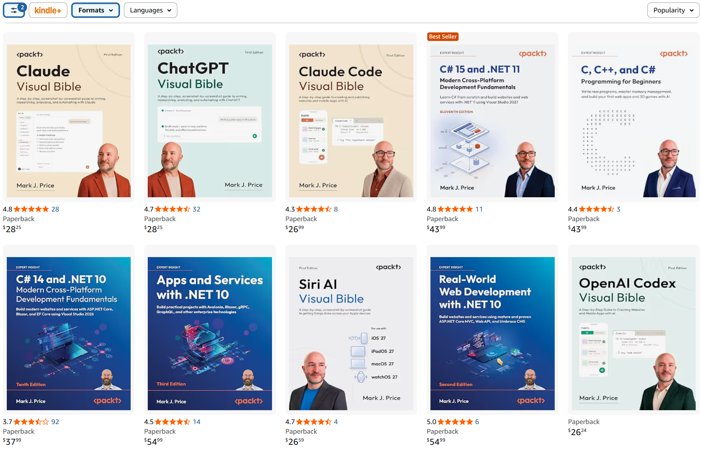

## Hi there 👋, I am Mark J. Price. Author. Teacher. Programmer.

- 📖 You can get my books from [Amazon](https://www.amazon.com/Mark-J-Price/e/B071DW3QGN/), my publisher [Packt](https://subscription.packtpub.com/search?query=mark+j.+price), or any good book store.
- 🤔 My Amazon author profile: https://www.amazon.com/stores/author/B071DW3QGN/about
- 📚 My Amazon book list: https://www.amazon.com/stores/author/B071DW3QGN/
- 📚 My [*AI Visual Bible* series](https://www.amazon.com/stores/page/A90E1828-D22A-49EC-BACE-9BDFA7057EB3) for non-technical knowledge workers:
   - 📗 *ChatGPT Visual Bible* September 9, 2026: https://www.amazon.com/dp/180865515X/
   - 📗 *OpenAI Codex Visual Bible* coming December 2026: https://www.amazon.com/dp/B0HKD6Q5SS/
   - 📕 *Claude Visual Bible* September 29, 2026: https://www.amazon.com/dp/1808658396/
   - 📕 *Claude Code Visual Bible* October 19, 2026: https://www.amazon.com/dp/B0HK3TCHMT/
   - 📘 *Siri AI Visual Bible* October 21, 2026: https://www.amazon.com/dp/1807427056/
   - 📘 *Microsoft Copilot Visual Bible* coming December 2026
   - 📙 *Everything AI Visual Bible* coming December 2026
   - 📙 *Gemini Visual Bible* coming January 2027
- 📚 I’m also working on a couple of books for intermediate-level AI operators:
   - 📙 *Building Agent Skills* coming January 2027
   - 📙 *Building Agent Teams* coming March 2027
- 🌱 You can read a [Q&A](q-and-a.md) with me.
- 💬 Ask me about any issues that you might be having with the code from my books in the [Packt Discord server channels](https://discordapp.com/channels/963343534323269662/1304404936355872788).
- 📫 How to reach me: `markjprice` is also my Gmail and MSN account names.
- ⚡ Michelle McNamara: "It’s chaos. Be kind."

---

# Ten of my most popular books on Amazon

# FAQs and other articles
- [Frequently Asked Questions](FAQs.md)
- [Articles](articles/README.md)

# What you should know about me

I am an ex-**Microsoft Certified Trainer (MCT)** with more than 30 years’ experience in the IT industry, including two years working full-time for Microsoft’s Training and Certification group in Redmond, USA. I specialize in training that leads to developer certifications.

I am eager to lead programming students, both experienced and new, into the challenging worlds of web, cloud, and mobile computing using a rare combination of thirty years’ education experience coupled with real world consulting and developing production systems for enterprises worldwide.

- I live in the south of England, UK.
- I'm experienced in the practical use of Microsoft developer tools and technologies.
- I'm dedicated to enthusiastic and dynamic training as a means of nurturing a lifelong love of programming.
- I used to design, write, and deliver standardized and custom programming courses.
- I'm adaptable and deal well with ambiguity in organizations of varying sizes and cultures.
- I hold an Honours Bachelor’s Degree in Computer Science.

I wrote three programming books for beginners in 2026:
- *[C, C++, and C# Programming for Beginners](https://www.amazon.com/dp/1806021293/)*: published November 10, 2026
- *[C# 15 and .NET 11 - Modern Cross-Platform Development Fundamentals](https://www.amazon.com/dp/1807306690/)*: published November 10, 2026
- *[Web Dev with an AI Sidekick](https://www.amazon.com/dp/180611125X/)*: published May 2026

I have written a quartet of guided learning books about C# 14 and .NET 10. Each has a GitHub repository with code solutions and extra materials:
- [C# 14 and .NET 10 - Modern Cross-Platform Development Fundamentals](https://github.com/markjprice/cs14net10/blob/main/README.md)
- [Real-World Web Development with .NET 10](https://github.com/markjprice/web-dev-net10/blob/main/README.md)
- [Apps and Services with .NET 10](https://github.com/markjprice/apps-services-net10/blob/main/README.md)
- [Tools and Skills for .NET 10](https://github.com/markjprice/tools-skills-net10/blob/main/README.md)

# Education and Certification

Highly qualified and experienced.

## Microsoft Certified Solutions Developer (MCSD)
- Web Applications
- Universal Windows Platform
- Windows Store Apps Using C#
- SharePoint Developer

## Microsoft Specialist
- Programming in C#
- Programming in HTML5 with JavaScript & CSS3
- Developing Microsoft Azure Solutions
- Architecting Microsoft Azure Solutions

## Microsoft Certified Trainer (MCT)
1993 - 2017

## Computer Science (BSc. Hons.)
University of Bristol, June 1993
