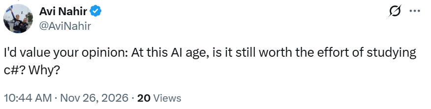

**QUESTION: Is it still worth studying C# now that AI can write code?**

https://x.com/AviNahir/status/2125903455772659954

**ANSWER: yes. But *how* you study it, and *why*, has changed.**

AI coding assistants are very good, and they keep getting better. They can write a method, scaffold a project, or explain an error message in seconds. They can build an entire playable 3D game in minutes with a well-briefed prompt and supporting Markdown files. So it's fair to ask whether learning a programming language is still worth the effort. Here's why I think it is, and why C# in particular is a good choice.

- [1. Someone still has to understand the code](#1-someone-still-has-to-understand-the-code)
- [2. Describing what you want precisely *is* programming](#2-describing-what-you-want-precisely-is-programming)
- [3. C# suits working with AI](#3-c-suits-working-with-ai)
- [4. C# skills are in demand and they last](#4-c-skills-are-in-demand-and-they-last)
- [5. AI makes learning C# *easier*](#5-ai-makes-learning-c-easier)
- [What *has* changed](#what-has-changed)
- [In summary](#in-summary)

# 1. Someone still has to understand the code

An AI can write code. You still have to decide whether that code is correct, secure, efficient, and what you actually wanted. You can't judge code you can't read.

AI-generated code often *looks* right and compiles, yet still has subtle problems. In C#, common ones include:

- An `async` method that blocks with `.Result` and deadlocks or starves the thread pool.
- A LINQ query that runs several times because of deferred execution.
- An `IDisposable` resource that never gets disposed.
- Nullable warnings that were silenced instead of fixed.
- Code that works with ten records and falls over with ten million.

If you know the language, you'll spot these in seconds. If you don't, you'll ship them. AI moves the developer's job from *typing* code to *reviewing, directing, and owning* it, and that takes more understanding, not less.

AI-generated code will get better at avoiding this common problems as users write more rules for them to check automatically so this problem will reduce over time.

# 2. Describing what you want precisely *is* programming

Getting good results from an AI means describing exactly what you want: the types, the edge cases, the error handling, the constraints. People who know the language and its idioms write much better prompts, and they can tell straight away when an answer is off. Vague understanding gets you vague code.

OTOH, someone like Steve Jobs was valuable even though he didn't code or engineer. Jobs wasn't technically clueless. He understood technology well enough to ask hard questions and to have an educated feeling about what was feasible, even though he couldn't build it himself. That's an important difference: he wasn't a non-technical manager guessing. He was a deeply informed critic and director. That should be your goal too.

Jobs was valuable because his strengths were the scarce ones: he knew what *should* be built, he could tell when it wasn't good enough yet, and he could get brilliant people to build it. Engineering talent was never what held Apple back. Wozniak, Bill Atkinson, Andy Hertzfeld, Jony Ive and many others supplied that.

Jobs' value showed up in a few ways.

- **Taste and judgement.** Jobs had an unusually clear sense of what would feel right to an ordinary person. He couldn't write the code for the Macintosh interface, but he could look at a demo and say "this is wrong, and here's why," and he was right often enough for that to matter. Being able to tell the difference between "works" and "great" is a rare skill.

- **Deciding what not to do.** When he returned to Apple in 1997, the company had a sprawling, confusing product line. He cut it down to four products: consumer and professional, desktop and portable. Saying no to good ideas so you can focus on great ones sounds simple, but most organisations can't do it.

- **Putting the pieces together.** He connected technologies, design, business deals and culture in ways nobody else did. The iPod mattered less as a device than as a whole system: the hardware, iTunes, and the deals with record labels. The iPhone combined a touchscreen, a real operating system and a carrier deal on Apple's terms. Each part needed engineers. Seeing the whole needed someone like him. This is why people talk about how software architecture is growing in importance compared to just coding statements.

- **Standards and pressure.** He was famously demanding, sometimes cruelly so. That side of him is a real part of the story, not something to romanticise. But his refusal to ship mediocre work pushed talented people to do the best work of their careers, and many of them said so later.

- **Storytelling.** He could explain why a product mattered in a way that made people want it, whether they were customers, the press, investors or his own staff. A great product that nobody understands often fails. An AI can build a software product for you, but most vibe coders then fall down at the next hurdle: getting customers to know about what their AI has built. Marketing and selling is even more important than ever.

As AI makes building cheaper, the skills Jobs had become relatively more valuable: knowing what's worth making, judging quality, and directing capable "builders." The catch is that his judgement rested on real understanding, and most people get that understanding by learning the craft themselves. The difference from ten years ago is that you don't need to learn the nitty-gritty details to as much depth. But you still need to learn the fundamentals.

# 3. C# suits working with AI

Some languages make AI-assisted development safer than others. C# has a lot going for it:

- **Strong, static typing.** The compiler acts as a safety net and catches a whole class of AI mistakes before the code ever runs.
- **Nullable reference types.** They make intent explicit and expose sloppy assumptions.
- **Excellent tooling.** Analyzers, refactoring, debugging, and testing in Visual Studio, VS Code, and Rider help you check what the AI produced.
- **A large, consistent ecosystem.** .NET follows clear conventions, so both humans and AI tools can produce code that's predictable and easy to maintain.

You can also use .NET to *build* AI-powered applications. It has first-class libraries for calling language models, working with embeddings, and building agents.

# 4. C# skills are in demand and they last

C# runs a huge amount of real-world software: enterprise systems, web APIs and cloud services, desktop apps, cross-platform mobile apps, and games (Unity uses C#). Those systems need people who understand them, can maintain and extend them, and can take responsibility when something breaks in production. That doesn't go away when code becomes cheaper to write.

The concepts you learn with C# also carry over to other languages: types, object-oriented and functional design, asynchronous programming, memory and performance, testing. Even if the tools change completely, that foundation keeps its value.

# 5. AI makes learning C# *easier*

This is the good news. You now have a patient tutor available at any hour. Use it well:

- **Write first, then compare.** Try to solve the problem yourself, then ask the AI for its version and work out why the two differ.
- **Ask "why", not just "how".** Get it to explain a compiler error, a design choice, or a trade-off.
- **Review its code like a senior developer would.** Ask yourself what could go wrong, then test it.
- **Don't let it think for you while you're learning the fundamentals.** If you can't explain a line of code, you don't own it yet.

# What *has* changed

Being honest, some things matter less than they used to. Memorising syntax and API details is less important. Design, reading code, debugging, testing, security, and judgement matter more. The most valuable developers aren't the fastest typists. They understand the system well enough to direct the AI, catch its mistakes, and make good decisions.

# In summary

AI doesn't replace knowing C#. It raises the value of knowing it *well*. If you learn the language properly and use AI as a powerful assistant rather than a substitute for understanding, you'll be far more productive than someone who relies on either one alone.
